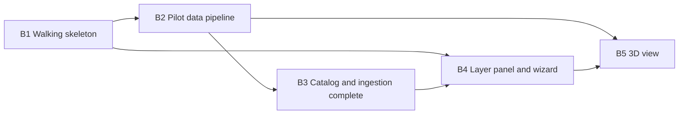

# Bolt Plan: Bogotá Urban Digital Twin

Upstream: `requirements.md` (Requirements Analysis), `stories.md` (User Stories), `mockups.md` (Refined Mockups), `components.md` (Domain Design), `unit-of-work.md`, `unit-of-work-dependency.md` and `unit-of-work-story-map.md` (Units Generation), `contract-summary.md` (Contract Design), `team-practices.md` (Practices Discovery). Answers: `delivery-planning-questions.md`.

A **Bolt** is one build pass over a piece of the work that ends in something that runs: one or more units of work with a definition of done, a hypothesis about what shipping it proves, and an owner. This plan orders the 11 units of work into 5 Bolts. The dependency graph in `unit-of-work-dependency.md` says what may depend on what; this plan chooses the path through it. Construction is not run in this repository: the build repositories consume this plan, one unit of work per change, in the order below.

## Ordering Rule

Confirmed answers (Q1 as resolved by Q7, Q2, Q3, Q4):

- The **walking skeleton** first: a minimal version that runs the whole way through (sign in, upload one dataset, see it on the map), built first to prove the pieces connect. It is Bolt 1, built alone and explicitly approved before any other Bolt starts, per the affirmed team practice in `team-practices.md`.
- The **riskiest part second**: the terrain, building-height and 3D pipeline for the pilot localidad (Bolt 2), immediately after the skeleton.
- **The rest by value**: catalog and ingestion completion, then the layer panel and wizard, then the 3D view.
- No formal scoring model; each Bolt's position is explained in plain words in `risk-and-sequencing-rationale.md`.
- Several related units per Bolt.
- After Bolt 1, two Bolts may run at the same time when independent: one backend Bolt and one web Bolt, each on its own short-lived branch, squash-merged to `main`.

## Bolt Sequence

| Bolt | Name | Units | Walking skeleton | Lane | Starts after | Merges after |
|---|---|---|---|---|---|---|
| B1 | Walking skeleton | U1, U2, U8 in full; skeleton slices of U3, U4, U9, U10 | yes | solo | nothing | nothing |
| B2 | Pilot localidad data pipeline | U6, U7 | no | backend (jobs) | B1 | B1 |
| B3 | Catalog and ingestion complete | U3, U4, U5 | no | backend (API) | B2 | B2 |
| B4 | Layer panel and add-data wizard | U9, U10 | no | web | B1 (alongside B2 and B3) | B3 |
| B5 | 3D view | U11 | no | web | B2 and B4 | B4 |

<!-- Text fallback: B1 comes first alone. After B1, B2 (backend lane) and B4 (web lane) start together. B3 follows B2 in the backend lane. B4 merges only after B3. B5 starts after both B2 and B4. -->

The answer to Q3 estimated six or seven Bolts; bundling whole units produced five. B2 is the one to split (cadastre first, terrain second) if the terrain work overruns its time box.

## B1: Walking skeleton

**Units**: U1 platform-core (full), U2 identity (full), U8 web-shell (full), plus the thinnest slice of U3 catalog, U4 ingestion, U9 web-upload and U10 web-layers that lets one uploaded dataset appear on the map. Solo and gated: built alone, explicitly approved before B2 and B4 start.

**Skeleton slices** (what B1 builds of each unit; the rest is completed in B3 or B4):

| Unit | In B1 | Completed in |
|---|---|---|
| U3 catalog | `layers` and `features` written through the Catalog service; `GET /api/layers` filtered by the simplest visibility rule (owner or everyone); `GET /api/layers/{layerId}` with extent; the backend-served tile endpoint `GET /api/tiles/{layerId}/{z}/{x}/{y}.mvt` under the current user, inside the request transaction | B3 |
| U4 ingestion | `POST /api/uploads` for GeoJSON with native geometry; the background job through the runner; job status polling; per-row failure recording; raw upload retention; the single coordinate conversion routine with its EPSG:9377 reference-point and round-trip tests | B3 |
| U9 web-upload | a minimal add-data form: layer name and file (GeoJSON only), then "Cargar" | B4 |
| U10 web-layers | the layer list with visibility checkbox, loading and error states, zoom to the new layer, empty state | B4 |

**Stories**: US1.1, US1.2, US1.3, US1.4, US4.4, US4.8, US6.1, US6.2, US7.1, US9.1 (in full); US2.1 (GeoJSON path), US2.2, US2.6, US2.7, US2.8, US2.9, US2.10, US4.1, US4.7 (skeleton slices).

**Definition of done**:
- Backend and web repositories exist with the affirmed practices in force: test-first, 80% line coverage enforced in CI, Black and Ruff, Prettier and ESLint, Angular strict mode, Alembic migrations applying cleanly to a fresh PostGIS container, secrets injected from the secret manager, secret scanner green.
- Every table of the shared schema (contract C6) exists through migrations; the reference fixture set (US9.1) loads into the disposable test database.
- A seeded researcher signs in with email and password, is redirected to sign-in when unauthenticated, and is rejected on data requests without a token (contract C1).
- The fixture GeoJSON uploads, runs as a background job, and its layer appears in the panel and on the map with the map zoomed to its extent; a fixture with three bad rows shows "3 filas con error".
- The health endpoint (contract C8) reports database and storage; a failed job leaves one structured log entry.
- Deployed to the shared environment from `main` on merge; the demo runs there, not on a laptop.

**Confidence hypothesis**: the architecture hangs together end to end before anything is scaled: backend-served vector tiles under the current user's row policy, a job runner separate from the request cycle, the Angular shell calling the map engine only through one map service, bearer-token tile requests, deploy on merge to Cloud Run, and test-first against a disposable PostGIS. If any of those fails here, it fails cheaply.

**Expected demo**: sign in as Camila, upload `puntos-muestreo.geojson`, watch the layer appear in the panel and on the map on the shared environment.

## B2: Pilot localidad data pipeline

**Units**: U6 jobs-cadastre, U7 jobs-terrain3d. Backend lane, right after B1. The riskiest Bolt by design (Q6: the terrain, heights and 3D pipeline worries the team most).

**Stories**: US9.2 (first), US3.1, US3.3, US3.4, US5.2 (data side), US5.6, US5.7 (data side).

**Order within the Bolt**: choose the pilot localidad and download its parcel, terrain and surface products (US9.2); load the pilot parcel fixture (US3.1) while terrain tiles are produced from the terrain model (US5.2 data); compute heights per parcel once parcels exist (US5.6); generate the 3D tile set (US5.7 data); run the full-city cadastre load when the IDECA release is available (US3.4), otherwise record the fallback in `external-dependency-map.md`.

**Definition of done**:
- The pilot parcel fixture in EPSG:9377 loads through the conversion routine with the reference centroid within 1 metre of its known WGS84 position; a malformed file fails with no partial layer active; a second run replaces the layer atomically and a failed second run leaves the previous layer intact.
- Terrain tiles for the pilot localidad are produced and stored; the fixture reference elevation is within 2 metres of the terrain-model value.
- Heights per parcel are computed as surface minus terrain and written through the Catalog service within 1 metre of the fixture value; parcels outside raster coverage are counted as empty, never zero.
- A 3D tile set of extruded parcels is generated and `GET /api/terrain` (contract C5) returns the pilot boundary and both tile locations.
- Every job reports per-row failures through the Job contract (C7); a job interrupted by a runner restart is marked INTERRUPTED.
- The full-city cadastre is loaded with a feature count equal to the release's record count, or the load is explicitly deferred with the reason recorded.

**Confidence hypothesis**: the team can produce terrain tiles, per-parcel heights and a 3D tile set for one localidad with open tooling, inside the USD 100 per month ceiling, without prior GIS or 3D experience. Shipping this Bolt validates or falsifies the 3D commitment (intent success metric 3) before the web work depends on it.

**Expected demo**: the jobs run on the shared environment; the tile set and terrain tiles open in a standalone viewer; the cadastre parcels are visible on the 2D map through the skeleton layer list.

## B3: Catalog and ingestion complete

**Units**: U3 catalog (complete), U4 ingestion (complete), U5 tile-serving (the documentation of the backend tile endpoint, its per-user cache rule and the latency measurement, owned by U3 since Contract Design). Backend lane, after B2.

**Stories**: US2.3, US2.4, US2.5 (data), US3.2 (data), US4.2 (data), US4.3 (data), US4.5, US4.6, US4.9, US6.3.

**Definition of done**:
- Per-layer visibility is enforced in the layer list, tiles and attributes by database row policies keyed by the current user set inside the request transaction; the negative tests (a non-allowed signed-in user gets an authorization error on direct tile and attribute requests) pass under a pooled connection.
- Detection covers native geometry, latitude and longitude columns, a WKT column and manual column choice, each with a smoke test; an upload matching none of them fails with a clear error; `POST /api/uploads/inspect` returns the detection result without loading.
- Styles, visibility grants, deletion with cascade (features, style, raw upload) and the attribute endpoint follow contract C2; failed rows are paged (contract C4).
- A 10 MB CSV fixture loads and its layer is active within 5 minutes on the shared environment (NFR2).
- The latency script requests city-scale cadastre tiles as 4 concurrent users and a report records the median and 95th-percentile response time (NFR1, US6.3).

**Confidence hypothesis**: row policies keyed per request are safe under connection pooling, and backend-served tiles hold measurable, reportable latency at city scale so a threshold can be set after the proof of concept.

**Expected demo**: a layer restricted to two users is invisible to the fourth even by direct tile request; a 10 MB CSV with three bad rows loads with the failures listed.

## B4: Layer panel and add-data wizard

**Units**: U9 web-upload (complete), U10 web-layers (complete). Web lane. Starts after B1 alongside B2 and B3, built against contracts C2 and C4 with stubs where B3 has not merged yet, per the parallel-development note in `unit-of-work-dependency.md`; merges after B3 so the definition of done runs against real endpoints.

**Stories**: US2.1 to US2.7 (interface), US2.10, US2.11, US3.2 (interface), US4.1, US4.2, US4.3, US4.5 (dialog), US4.6 (dialog and step 3), US4.7, US7.2 (panel and wizard on tablet).

**Definition of done**:
- The three-step "Agregar datos" wizard of `mockups.md` screen S2, including detection review, manual column choice, visible columns, visibility in step 3 and the cancel confirmation; the job detail dialog (S3) with every failed row.
- The layer panel of screen S1: toggles, inline style control applied live, three-dot menu with "Estilo", "Visibilidad", "Eliminar" shown only to the uploader, the feature popup with "Sin valor" and its retry state, the visibility dialog (S4) and delete confirmation (S5), the empty state.
- Spanish labels throughout; the tablet layout with the panel as a drawer and 44 by 44 pixel controls.
- Browser tests for each acceptance criterion; CI green at the coverage floor.

**Confidence hypothesis**: a researcher loads a dataset as a map layer without developer help (intent success metric 1). Measured by one of the four researchers completing a scripted walkthrough with zero developer intervention.

**Expected demo**: Camila's survey CSV goes end to end through the wizard on a tablet, then she styles it and reads a popup.

## B5: 3D view

**Units**: U11 web-3d. Web lane, after B2 (tile locations) and B4 (the layer panel it mounts into).

**Stories**: US5.1, US5.2 (view), US5.3, US5.4, US5.5, US5.7 (view), US7.2 (tilt gesture).

**Definition of done**:
- The 2D / 3D toggle keeps the map position; "Cargando terreno..." shows while tiles arrive.
- Inside the pilot localidad, terrain relief and extruded buildings render with the reference parcel within 1 metre of its stored height; parcels with no height render flat.
- Outside the pilot localidad, terrain is flat, no buildings appear and the boundary banner explains why.
- Uploaded and cadastre layers stay visible and clickable in 3D; hidden layers stay hidden.
- If terrain fails to load, the view returns to 2D with "La vista 3D no está disponible ahora".
- Two-finger drag tilts on a tablet.

**Confidence hypothesis**: terrain and building heights render in 3D for the pilot localidad in the browser on the shared environment (intent success metric 3), with load behaviour a demo can tolerate.

**Expected demo**: the third success metric, live: switch to 3D over the pilot localidad, tilt, click a building and read its popup.

## Story Coverage

| Group | Stories | Bolt |
|---|---|---|
| 1 Accounts | US1.1 to US1.4 | B1 |
| 2 Upload | US2.1 to US2.11 | B1 (skeleton slices), B3 (data), B4 (interface) |
| 3 Cadastre | US3.1, US3.3, US3.4 | B2 |
| 3 Cadastre | US3.2 | B3 (data), B4 (interface) |
| 4 Layer panel | US4.4, US4.8, US4.1, US4.7 | B1 |
| 4 Layer panel | US4.2, US4.3, US4.5, US4.6, US4.9 | B3 (data), B4 (interface) |
| 5 3D | US5.2, US5.6, US5.7 (data) | B2 |
| 5 3D | US5.1, US5.3, US5.4, US5.5, US5.7 (view) | B5 |
| 6 Operations | US6.1, US6.2 | B1 |
| 6 Operations | US6.3 | B3 |
| 7 Interface | US7.1 | B1 |
| 7 Interface | US7.2 | B4, B5 |
| 8 Later | US8.1 to US8.4 | deferred (no unit in this piece of work) |
| 9 Enablers | US9.1 | B1 |
| 9 Enablers | US9.2 | B2 |

All 42 assigned stories land in a Bolt; the 4 deferred stories stay deferred as recorded in `unit-of-work-story-map.md`.

## Branching and Merge

From the affirmed way of working: each Bolt is a short-lived branch based on `main` and squash-merged to `main`, one commit per Bolt named by the Bolt slug (`bolt-walking-skeleton`, `bolt-pilot-data-pipeline`, `bolt-catalog-ingestion`, `bolt-layer-panel-wizard`, `bolt-3d-view`). Self-review checklist before merge, no second approver. Every merge deploys the shared environment. After B1 ships, the standard prompt decides whether the remaining Bolts run autonomously or gated; that choice is recorded in the workflow state, not here.

## Assumptions & Open Questions

- The skeleton slices of U3 and U4 give U7 everything it needs from the Catalog and Job services (create layer, write features and heights, Job lifecycle, coordinate conversion); if U7 needs Catalog behaviour beyond the slice, that piece is pulled forward into B2 and recorded in the rationale. [assumption]
- With one developer instead of two, the two lanes serialize: B2, B3, B4, B5. [assumption]
- The build repositories consume one unit of work as one change; a Bolt is the grouping of those changes into a demo-able increment, not a change itself. [assumption]
