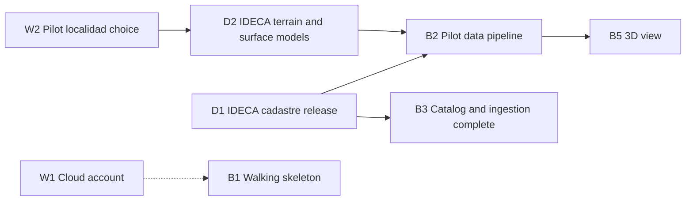

# External Dependency Map: Bogotá Urban Digital Twin

Upstream: `bolt-plan.md` (this stage), `requirements.md` (constraints C-B, C-C, C-D; Open Questions), `stories.md` (US3.4, US9.2), `team-practices.md` (cloud account not yet confirmed), `unit-of-work.md`, `unit-of-work-dependency.md`, `unit-of-work-story-map.md`, `components.md`, `contract-summary.md`, `mockups.md`. Answers: `delivery-planning-questions.md` (Q5).

A **Bolt** is one build pass over a piece of the work that ends in something that runs. This file lists what outside the team can hold a Bolt up, who owns it, how long it takes, which Bolt it blocks and what happens if it slips. No external API is consumed in this piece of work (Contract Design), so every gated item is a data download or a decision.

## Gated Dependencies (answer Q5)

| # | Dependency | Owner | Lead time | Blocks | Needed by | Fallback if it slips |
|---|---|---|---|---|---|---|
| D1 | Official cadastre release from IDECA (parcels for all of Bogotá, with number of floors where published, EPSG:9377) | Research team downloads from the IDECA open-data portal; a developer verifies the coordinate system and record count | Hours to a few days if published openly; longer if a request form is required | B2 (US3.4 full-city load), B3 (US6.3 latency measurement at city scale) | Start of B2 for the pilot subset; before the end of B2 for the full city | B2 loads the pilot-localidad parcel fixture (US3.1) and proves the repeatable loader; the full-city load is recorded as deferred with the reason and runs as soon as the release is on disk; the latency report in B3 waits for it |
| D2 | Terrain model and surface model for the pilot localidad from IDECA | Research team downloads; a developer confirms EPSG:9377 (or records otherwise) and stores the files with source and download date (US9.2) | Hours to a few days; the products are large, so download and storage must be planned | B2 (US5.2, US5.6, US5.7 data side), and through it B5 | Start of B2 | The pipeline is proven first on a small clipped fixture with known elevations (US9.1); if the pilot products are late, an openly available coarser elevation model stands in to exercise the tooling, clearly labelled as not the deliverable, and the pilot run repeats when the real products arrive |

## Watched, Not Gating

The team did not mark these as blockers (Q5). They are tracked so a slip is noticed, not so a Bolt waits on them.

| # | Item | Owner | Why it is watched | Where it lands |
|---|---|---|---|---|
| W1 | Cloud account and billing owner (GCP preferred, not yet confirmed) | The three organisations | B1's definition of done includes deploying the shared environment on merge; without an account, B1's code is complete but its demo runs on Docker Compose until the account exists | B1 |
| W2 | Choice of the pilot localidad | Research team | US9.2 is the first story of B2; D2 cannot be downloaded before it | B2 |
| W3 | Team availability: one developer instead of two | The three organisations | The two lanes in `team-allocation.md` serialize; elapsed time grows, the plan does not change | B2 onwards |

## Dependency-to-Bolt Map

<!-- Text fallback: D1 feeds B2 and B3. D2 feeds B2. W2 precedes D2. W1 affects only B1's deploy step (dotted). B2 feeds B5. B4 has no external dependency. -->

## Handling Rules

- A gated item is checked at the start of the Bolt that consumes it; if it is not on disk, the Bolt begins with the fallback and records the deferral in its definition-of-done review.
- Downloaded products are stored with source, download date and checksum (raster asset registry in `components.md`) so a later release can be told apart from the one the demo used.
- A slip that pushes the full-city cadastre past the end of B3 is escalated to this plan: the latency measurement moves to B5's time window rather than blocking B3's merge.

## Assumptions & Open Questions

- IDECA products are downloadable without a special request; if a request form is required, the lead time in D1 and D2 grows by the agency's response time. [assumption, carried from `requirements.md`]
- No commercial service is needed in this piece of work; the geocoding API key named in `team-practices.md` belongs to a deferred capability (US8.1). [assumption]
