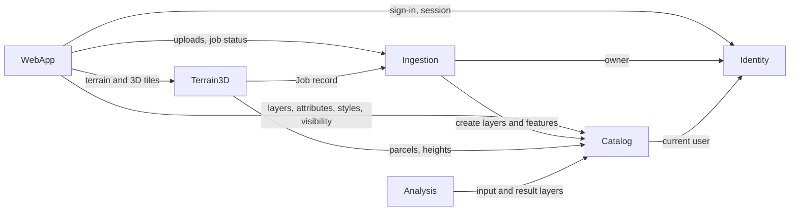

# Component Catalogue: Bogotá Urban Digital Twin

Upstream: `requirements.md` (FR/NFR), `stories.md` (US), `team-practices.md` (module boundaries through service layers, TDD). Answers: `domain-design-questions.md`. This catalogue names the logical building blocks (code the team writes). Deployment topology is decided at Units Generation; technology choices and NFR patterns at later stages. Databases, object storage, the off-the-shelf tile servers and the map engine are external dependencies, not components.

## Part A: Machine-readable catalogue

```yaml
components:
  - name: Identity
    summary: Accounts, sign-in and sessions for the four researchers
    behaviour: >
      Verifies email and password against salted hashes; issues a session valid
      for 12 hours; rejects any request without a valid session with an explicit
      authentication error; exposes the current user's identity to every other
      component; accounts are seeded at deployment, no self-registration; the
      single role has administrator rights. Never reveals whether an email exists.
    responsibilities:
      - Authenticate users and manage session lifetime
      - Provide the current user to the request context used by row policies
      - Seed and list the four accounts
    depends_on: []
    dependents:
      - component: WebApp
        interaction: sign-in, sign-out, session check
      - component: Catalog
        interaction: current user for ownership and visibility policies
      - component: Ingestion
        interaction: owner of a job and its resulting layer
    external_dependencies:
      - name: PostgreSQL
        kind: database
        purpose: users and sessions
    entities:
      - name: User
        identifier: userId
        attributes: [email, passwordHash, displayName, createdAt]
      - name: Session
        identifier: sessionId
        attributes: [userId, issuedAt, expiresAt]
        references:
          - entity: User
            owned_by: Identity
            relationship: each Session belongs to one User

  - name: Catalog
    summary: Datasources, layers, features, styles and who may see each layer
    behaviour: >
      Owns the layer registry and all vector features in the map coordinate
      system (EPSG:4326). Enforces per-layer visibility with database row
      policies keyed by the current user, so tiles and attributes served directly
      from the database honour the same rule as the layer list. Only the uploader
      may change a layer's visibility or delete it; deleting a layer removes its
      features, its style and its raw upload reference. Keeps per-user style
      settings. Stores per-parcel building heights supplied by Terrain3D as a
      feature attribute.
    responsibilities:
      - Layer and datasource registry, feature storage and attribute lookup
      - Visibility grants and their enforcement through row policies
      - Per-user layer styles
      - Layer deletion with cascade
    depends_on:
      - component: Identity
        interaction: current user for ownership and visibility
        style: sync
    dependents:
      - component: WebApp
        interaction: layer list, attributes, styles, visibility, delete
      - component: Ingestion
        interaction: create datasource, layer and features on load
      - component: Terrain3D
        interaction: read parcels, write building heights
      - component: Analysis
        interaction: read input layers, write result layers
    external_dependencies:
      - name: PostgreSQL with PostGIS
        kind: database
        purpose: layers, features, spatial index, row policies
      - name: Vector tile server
        kind: other
        purpose: serves map tiles straight from the feature tables under the row policies
    entities:
      - name: Datasource
        identifier: datasourceId
        attributes: [name, kind, sourceUri, sourceCrs, schema, loadedAt, ownerUserId]
        references:
          - entity: User
            owned_by: Identity
            relationship: each Datasource is owned by one User
      - name: Layer
        identifier: layerId
        attributes: [datasourceId, name, geometryType, visibleFields, defaultStyle, featureCount, ownerUserId, createdAt]
        references:
          - entity: Datasource
            owned_by: Catalog
            relationship: each Layer comes from one Datasource
          - entity: User
            owned_by: Identity
            relationship: each Layer is owned by one User
      - name: Feature
        identifier: featureId
        attributes: [layerId, geom, properties, heightM, validFrom, validTo]
        references:
          - entity: Layer
            owned_by: Catalog
            relationship: each Feature belongs to one Layer
      - name: VisibilityGrant
        identifier: grantId
        attributes: [layerId, userId, mode]
        references:
          - entity: Layer
            owned_by: Catalog
            relationship: each grant applies to one Layer
          - entity: User
            owned_by: Identity
            relationship: each grant names one User, or all users when mode is everyone
      - name: LayerStyle
        identifier: styleId
        attributes: [layerId, userId, color, opacity, pointSize]
        references:
          - entity: Layer
            owned_by: Catalog
            relationship: each style belongs to one Layer
          - entity: User
            owned_by: Identity
            relationship: each style belongs to one User

  - name: Ingestion
    summary: Background jobs that turn files into layers, with per-row failure reporting
    behaviour: >
      Accepts an upload request (name, file, geometry source, visible columns,
      visibility), keeps the raw file first, validates size and format, detects
      geometry in order (native GeoJSON, then coordinate columns), converts every
      geometry to EPSG:4326 through one shared conversion routine, writes
      features through Catalog, and records every failed row with its reason on
      the Job; never drops a row silently. Owns the Job record used by uploads,
      the cadastre load and the height computation. Reports job status to the
      interface.
    responsibilities:
      - Upload validation and geometry detection
      - Coordinate conversion (single routine, EPSG:9377 to EPSG:4326 and others)
      - Job lifecycle, timings, per-row failures
      - Raw upload retention
      - Cadastre load job from the official format
    depends_on:
      - component: Catalog
        interaction: create datasource, layer and features; set visibility
        style: sync
      - component: Identity
        interaction: owner of the job and layer
        style: sync
    dependents:
      - component: WebApp
        interaction: start uploads, read job status and failed rows
      - component: Terrain3D
        interaction: uses the Job record for the height computation
    external_dependencies:
      - name: Object storage
        kind: object-store
        purpose: raw uploaded files
      - name: PostgreSQL with PostGIS
        kind: database
        purpose: jobs and failures
      - name: Job runner
        kind: other
        purpose: runs jobs outside the request cycle
    entities:
      - name: Job
        identifier: jobId
        attributes: [kind, status, startedAt, finishedAt, rowsTotal, rowsLoaded, rowsFailed, ownerUserId, layerId, message]
        references:
          - entity: User
            owned_by: Identity
            relationship: each Job is started by one User
          - entity: Layer
            owned_by: Catalog
            relationship: a Job produces or updates one Layer
      - name: JobRowFailure
        identifier: failureId
        attributes: [jobId, rowNumber, reason]
        references:
          - entity: Job
            owned_by: Ingestion
            relationship: each failure belongs to one Job
      - name: RawUpload
        identifier: rawUploadId
        attributes: [jobId, fileName, sizeBytes, storageUri, uploadedAt, checksum]
        references:
          - entity: Job
            owned_by: Ingestion
            relationship: each raw upload belongs to one Job

  - name: Terrain3D
    summary: Terrain and surface rasters, per-parcel building heights, 3D tiles for the pilot localidad
    behaviour: >
      Registers terrain and surface products for the pilot localidad, produces
      terrain tiles for the 3D view, computes building height per parcel as
      surface minus terrain, writes the height on the parcel through Catalog,
      counts parcels outside raster coverage as empty (never zero), and generates
      the 3D tile set of extruded parcels. Bound to the pilot localidad until a
      separate cost decision.
    responsibilities:
      - Raster asset registry and terrain tile production
      - Building height computation per parcel
      - 3D tile set generation
    depends_on:
      - component: Catalog
        interaction: read parcels, write heights
        style: sync
      - component: Ingestion
        interaction: Job record for the height computation
        style: sync
    dependents:
      - component: WebApp
        interaction: terrain and 3D tile locations for the 3D view
    external_dependencies:
      - name: Object storage
        kind: object-store
        purpose: rasters, terrain tiles, 3D tiles
      - name: Raster tile server
        kind: other
        purpose: serves raster products as tiles when needed
    entities:
      - name: RasterAsset
        identifier: rasterAssetId
        attributes: [kind, localidad, storageUri, resolutionM, sourceCrs, sourceDate, checksum]
      - name: TileSet
        identifier: tileSetId
        attributes: [kind, localidad, storageUri, generatedAt, sourceLayerId]
        references:
          - entity: Layer
            owned_by: Catalog
            relationship: a 3D TileSet is generated from one parcel Layer

  - name: Analysis
    summary: Scenario runs that read layers and rasters and write result layers (later phases)
    behaviour: >
      A model receives input layers and parameters, runs as a job, and writes a
      result layer plus a Scenario record. Exploratory in this piece of work; the
      seam exists so the twin can host models later.
    responsibilities:
      - Scenario record and model registry
      - Result layer creation
    depends_on:
      - component: Catalog
        interaction: read input layers, write result layers
        style: sync
    dependents: []
    external_dependencies:
      - name: Job runner
        kind: other
        purpose: runs model jobs
    entities:
      - name: Scenario
        identifier: scenarioId
        attributes: [model, parameters, inputLayerIds, resultLayerId, status, createdAt]
        references:
          - entity: Layer
            owned_by: Catalog
            relationship: a Scenario reads input Layers and produces one result Layer

  - name: WebApp
    summary: The Spanish single-page interface, one shell with a single map service wrapping the engine
    behaviour: >
      Sign-in, layer panel, add-data wizard, feature popup, 2D/3D view mode, job
      detail, visibility and delete dialogs. All features reach the map through
      one map service that wraps the engine; no feature calls the engine
      directly. Shows job status live, Spanish labels, desktop and tablet layouts.
    responsibilities:
      - Screens and interaction states
      - Map service wrapping the engine (2D, 3D, layers, popups, camera)
      - Session handling on the client
    depends_on:
      - component: Identity
        interaction: sign-in, sign-out, session check
        style: sync
      - component: Catalog
        interaction: layer list, attributes, styles, visibility, delete
        style: sync
      - component: Ingestion
        interaction: start uploads, read job status and failed rows
        style: sync
      - component: Terrain3D
        interaction: terrain and 3D tile locations for the 3D view
        style: sync
    dependents: []
    external_dependencies:
      - name: Map engine
        kind: other
        purpose: 2D and 3D rendering, terrain and 3D tiles
      - name: Vector tile server
        kind: other
        purpose: map tiles for vector layers
    entities: []
```

## Component Diagram



Text fallback: WebApp calls Identity, Catalog, Ingestion and Terrain3D. Ingestion calls Catalog and Identity. Catalog calls Identity. Terrain3D calls Catalog and Ingestion. Analysis calls Catalog. No cycles.

## Component Summary

| Component | Purpose | Depends On | Dependents | Entities Owned |
|---|---|---|---|---|
| Identity | Accounts, sign-in, sessions | none | WebApp, Catalog, Ingestion | User, Session |
| Catalog | Layers, features, styles, visibility | Identity | WebApp, Ingestion, Terrain3D, Analysis | Datasource, Layer, Feature, VisibilityGrant, LayerStyle |
| Ingestion | Upload and load jobs, conversion, failures | Catalog, Identity | WebApp, Terrain3D | Job, JobRowFailure, RawUpload |
| Terrain3D | Rasters, heights, 3D tiles for the pilot localidad | Catalog, Ingestion | WebApp | RasterAsset, TileSet |
| Analysis | Scenario runs (later) | Catalog | none | Scenario |
| WebApp | Spanish interface with one map service | Identity, Catalog, Ingestion, Terrain3D | none | none |

## Entity Ownership

| Entity | Owning Component | Identifier | Attributes | References |
|---|---|---|---|---|
| User | Identity | userId | email, passwordHash, displayName, createdAt | none |
| Session | Identity | sessionId | userId, issuedAt, expiresAt | User |
| Datasource | Catalog | datasourceId | name, kind, sourceUri, sourceCrs, schema, loadedAt, ownerUserId | User |
| Layer | Catalog | layerId | datasourceId, name, geometryType, visibleFields, defaultStyle, featureCount, ownerUserId, createdAt | Datasource, User |
| Feature | Catalog | featureId | layerId, geom, properties, heightM, validFrom, validTo | Layer |
| VisibilityGrant | Catalog | grantId | layerId, userId, mode | Layer, User |
| LayerStyle | Catalog | styleId | layerId, userId, color, opacity, pointSize | Layer, User |
| Job | Ingestion | jobId | kind, status, startedAt, finishedAt, rowsTotal, rowsLoaded, rowsFailed, ownerUserId, layerId, message | User, Layer |
| JobRowFailure | Ingestion | failureId | jobId, rowNumber, reason | Job |
| RawUpload | Ingestion | rawUploadId | jobId, fileName, sizeBytes, storageUri, uploadedAt, checksum | Job |
| RasterAsset | Terrain3D | rasterAssetId | kind, localidad, storageUri, resolutionM, sourceCrs, sourceDate, checksum | none |
| TileSet | Terrain3D | tileSetId | kind, localidad, storageUri, generatedAt, sourceLayerId | Layer |
| Scenario | Analysis | scenarioId | model, parameters, inputLayerIds, resultLayerId, status, createdAt | Layer |

## External Dependencies

| Component | Dependency | Kind | Purpose |
|---|---|---|---|
| Identity | PostgreSQL | database | users and sessions |
| Catalog | PostgreSQL with PostGIS | database | layers, features, spatial index, row policies |
| Catalog | Vector tile server | other | tiles straight from feature tables under row policies |
| Ingestion | Object storage | object-store | raw uploads |
| Ingestion | PostgreSQL with PostGIS | database | jobs and failures |
| Ingestion | Job runner | other | runs jobs outside the request cycle |
| Terrain3D | Object storage | object-store | rasters, terrain tiles, 3D tiles |
| Terrain3D | Raster tile server | other | raster products as tiles when needed |
| Analysis | Job runner | other | model jobs |
| WebApp | Map engine | other | 2D and 3D rendering |
| WebApp | Vector tile server | other | vector layer tiles |

## Rationale

| Component | Why a separate building block | Alternatives rejected |
|---|---|---|
| Identity | Distinct concern (authentication) with its own change rate; every other block only needs "who is the current user" | Folding into Catalog (Q1 option B): would couple session handling to the layer registry and blur the row-policy boundary |
| Catalog | Owns the data every other block reads or writes; the row policies live here so visibility is enforced once | Splitting visibility into its own block: it is data ownership, not behaviour, and would create a second owner of Layer |
| Ingestion | Distinct lifecycle (background jobs) and the affirmed hard rule on per-row failures live here; the single conversion routine is owned once | Per-job-type status records (Q4 option B): would duplicate the failure-reporting rule across three job kinds |
| Terrain3D | Distinct data (rasters, tiles), distinct skills and the highest learning risk; bounded to the pilot localidad; separable if the pipeline is later replaced | Inside Ingestion (Q5 option B): raster processing has nothing in common with row-oriented loads except the Job record, which it reuses |
| Analysis | The seam that makes the viewer a twin; exploratory now, so kept thin | Omitting it: the initial description asks for the seam from day one |
| WebApp | Separate deliverable, its own change rate; one map service keeps the engine replaceable without feature modules | Direct engine use from every feature (Q3 as first answered): overruled by Q6, which keeps a single map service |

When only one decomposition was viable for a block, the option block was skipped; the two real choices (visibility enforcement, frontend structure) are recorded as ADRs in `decisions.md`.

## Assumptions & Open Questions

- Row policies keyed by the current user require the tile server to run each request under that user's identity; the mechanism (a per-request parameter validated by a database function, or a connection per user) is chosen at Contract Design. [assumption]
- Terrain and 3D tiles are public within the team (no per-layer visibility on rasters) for the proof of concept. [assumption]
