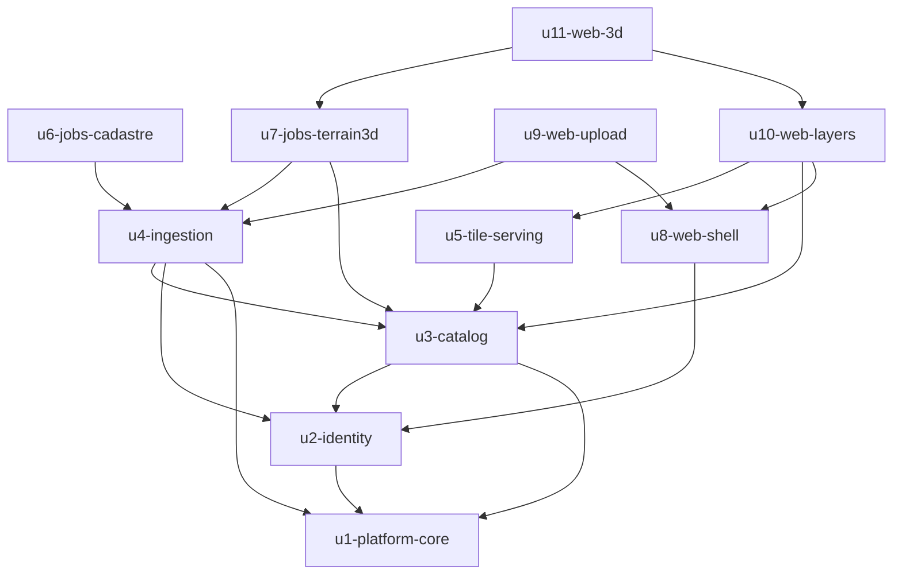

# Unit Dependency Graph: Bogotá Urban Digital Twin

Upstream: `unit-of-work.md`, `components.md`, `decisions.md`, `requirements.md`, `stories.md`. Topology only: this file says what may depend on what; Delivery Planning chooses the order.

## Edge Block

```yaml
units:
  - name: u1-platform-core
    kind: service
    depends_on: []
  - name: u2-identity
    kind: service
    depends_on: [u1-platform-core]
  - name: u3-catalog
    kind: service
    depends_on: [u1-platform-core, u2-identity]
  - name: u4-ingestion
    kind: service
    depends_on: [u1-platform-core, u2-identity, u3-catalog]
  - name: u5-tile-serving
    kind: spec
    depends_on: [u3-catalog]
  - name: u6-jobs-cadastre
    kind: service
    depends_on: [u4-ingestion]
  - name: u7-jobs-terrain3d
    kind: service
    depends_on: [u3-catalog, u4-ingestion]
  - name: u8-web-shell
    kind: ui
    depends_on: [u2-identity]
  - name: u9-web-upload
    kind: ui
    depends_on: [u8-web-shell, u4-ingestion]
  - name: u10-web-layers
    kind: ui
    depends_on: [u8-web-shell, u3-catalog, u5-tile-serving]
  - name: u11-web-3d
    kind: ui
    depends_on: [u10-web-layers, u7-jobs-terrain3d]
```

## Dependency Diagram



Text fallback: arrows point from a unit to what it depends on. U1 depends on nothing. U2 on U1. U3 on U1, U2. U4 on U1, U2, U3. U5 on U3. U6 on U4. U7 on U3, U4. U8 on U2. U9 on U8, U4. U10 on U8, U3, U5. U11 on U10, U7. The graph is acyclic.

## Integration Points

| From | To | Kind | What crosses |
|---|---|---|---|
| U2, U3, U4, U6, U7 | U1 | shared schema and migrations | Tables for every entity, fixtures, logging and config |
| U3, U4 | U2 | in-process service call | Current user from the session middleware |
| U4, U6, U7 | U3 | in-process service call | Create layers, write features and heights, set visibility |
| U6, U7 | U4 | in-process service call | Job record, coordinate conversion routine |
| U5 | U3 | database contract | Feature and layer tables exposed under row policies; the function that sets the current user |
| U8 | U2 | JSON HTTP | Sign-in, sign-out, session check |
| U9 | U4 | JSON HTTP | Upload, job status, failed rows |
| U10 | U3 | JSON HTTP | Layer list, attributes, styles, visibility, delete |
| U10, U11 | U5 | tile protocol | Vector tiles under the caller's identity |
| U11 | U7 | static file locations through U3 | Terrain tiles, 3D tile set, pilot boundary |

Contracts crossing HTTP or the tile protocol (U8 to U2, U9 to U4, U10 to U3, U10 and U11 to U5, U11 to U7) are formalized at Contract Design; in-process calls follow the service-layer rule from the affirmed practices.

## Parallel Development Opportunities

Sets with no dependency between their members (each set may proceed at the same time once its own dependencies exist):

- After U1: U2 alone, then U3 and U8 together.
- After U3: U4, U5 together; U8 continues.
- After U4: U6, U7, U9 together; after U5 and U8: U10.
- U11 waits for U10 and U7.
- The web units may start against agreed contracts before their backend counterpart is complete (answer Q4), using stubs of the U2, U3, U4 and U5 contracts.

Several topological orders are valid; none is recommended here.

## Assumptions & Open Questions

- U8 depends only on U2 because the shell needs sign-in to render anything; if a public landing screen is later wanted, the edge can drop. [assumption]
